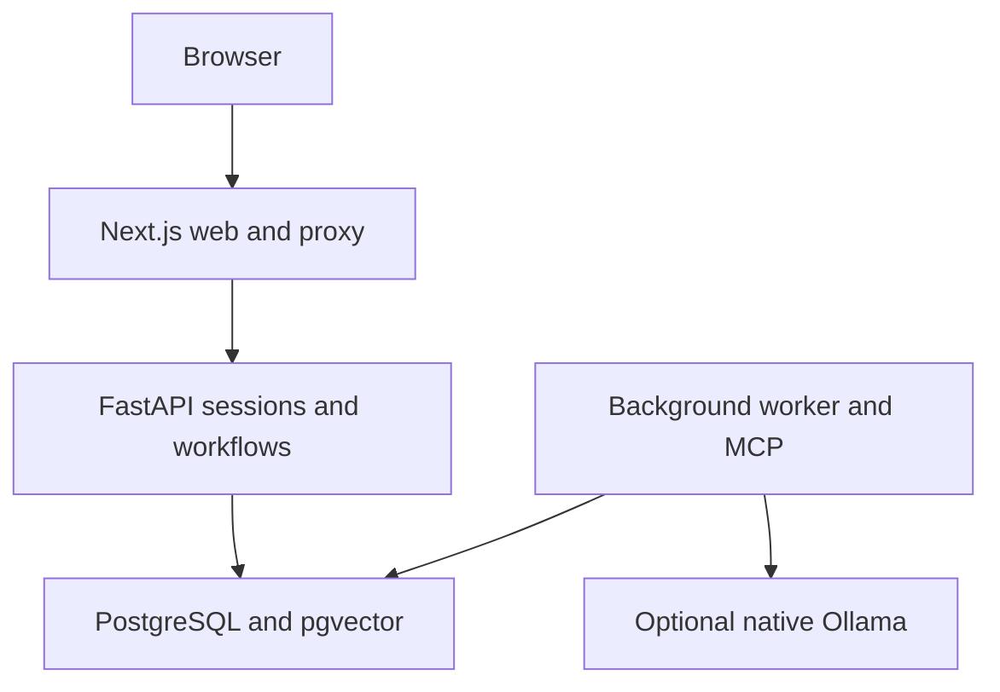

# TrialOps 2.0 · Graphite & Copper

Work directly in `~/Downloads/trialops-release`; keep using http://localhost:3001. This integrated release adds reviewed investigation checks, information requests, immutable comparisons, current-evidence resolution, measured activity, monitoring preparation, reminders, preview imports, complete case packages, versioned evaluations and a resumable sample walkthrough.

Begin with [START-HERE.md](START-HERE.md), [RELEASE-2.0.md](RELEASE-2.0.md) and [RELEASE-VERIFICATION.md](RELEASE-VERIFICATION.md). Existing accounts, data, configuration and secrets are preserved by additive migrations.

# Application reference

A complete application for clinical operations **support evaluation**: submit an issue, find documented procedures, inspect historical operational records, review an investigation, and record resolution. It is not a patient-care system or an enterprise compliance-certified platform.

This project remains separate from any older `trialops-ai` installation. Its stable Docker project is `trialops-release`.

## Start on your Mac

1. Open Docker Desktop and wait until it is running.
2. For an existing installation, follow START-HERE.md in this project. Use the installer only for a clean installation.
3. In Terminal run:

```bash
cd ~/Downloads/trialops-release
bash install.sh
```

Open **http://localhost:3001** and choose **Explore a sample case**. The first Docker build downloads dependencies and can take several minutes. Subsequent starts are faster. The new application uses a separate Docker project and database volume; port 3001 avoids the old port 3000 application.

The installer detects local `qwen2.5:7b` and `nomic-embed-text:v1.5`. If both are available through Ollama, it enables LLM-assisted source selection and pgvector retrieval. Otherwise it starts in **procedure mode**, with explicit text matching and no LLM. The UI and each saved investigation identify the actual mode. Intake classification uses keywords and requires review in both modes.

## The first complete walkthrough

1. Expand **Explore sample scenarios** on Overview and choose **Missing certificate**.
2. Select **Run investigation**. The job continues if you leave the page.
3. Inspect the cited procedure, its version, the dated snapshot, and any unsent drafts. A recorded condition does not establish current status or root cause.
4. Add review notes and approve or reject the documented recommendation.
5. In **Evidence & follow-up**, suggest checks, review/edit and activate them, record a current human observation, and assess each check with evidence. Resolve separately with that observation, reviewer notes, verification time and explained exceptions. Approval alone does not close the case.
6. Reopen the case with a reason if needed. Both events remain in activity.
7. Reopen the saved investigation from **Investigations**; its evidence is frozen even after procedures or snapshots change.
8. Try **Unsupported request** from the sample scenarios. An unrelated request should abstain; approval is blocked. Try **Healthy status check**: no failed-job or 15-minute certificate escalation should appear.
9. Upload a `.txt`, `.md`, or text-based PDF in **Knowledge**. Review its extracted text before saving. PDFs are limited to 2 MB and 30 pages; scanned PDFs need external OCR.
10. Submit feedback. Owners can view workspace feedback; the deployment operator can export all submitted feedback.

Sample workspaces expire after 24 hours. A permanent account starts a separate seeded workspace and uses a seven-day session. Sample contents are not automatically transferred into a permanent account.

## Included workflows

| Area | Behavior |
| --- | --- |
| Onboarding | Public landing page, guided sample scenarios, in-product guide |
| Accounts | Password sign-in, isolated workspaces, logout, workspace switching |
| Team roles | Owner, reviewer, analyst; one-use 24-hour invitation codes |
| Contexts | Owner-managed studies and research sites, validated study/site relationships |
| Intake | Context-dependent sites, reviewed category and priority suggestions |
| Case queue | Search, priority/status/personal views, pagination, saved filters, requested previews, owner and deadline |
| Investigations | Durable background jobs, six scoped MCP evidence tools, frozen results |
| Knowledge | Text/PDF extraction, chunks, current-version retrieval, edit conflicts, archive/restore |
| Operational evidence | Scoped synthetic snapshot import, timestamps, record-backed observations |
| Drafts | Deterministic documented conditions; unsent, copyable escalation text |
| Human decisions | Support required for approval; separate manual resolve/reopen actions |
| Audit | Saved reviewer, notes, timestamps, case activity, MCP trace |
| ROI | Explicit assumptions, one scenario per approved run; negative estimates preserved |
| Feedback & export | Ratings/comments, workspace JSON export, operator feedback export |
| Operations | Separate database, backup/restore scripts, health checks, TLS deployment configuration |

Automatic escalation drafts currently cover the canonical built-in KB-001 certificate-pending and KB-004 failed-synchronization procedures. Edited or custom procedures remain available as cited checks; they do not automatically gain an executable draft rule.

An analyst can submit cases, investigate, assign, and add notes. Reviewers can additionally approve/reject and resolve/reopen. Owners also manage knowledge, snapshots, invitations, and workspace exports. Roles are enforced by the API, not just hidden buttons.

## Verify your installation

```bash
bash scripts/test.sh
```

The suite includes deterministic policy tests and integration checks using temporary isolated accounts. Integration tests exercise the real running API, worker, PostgreSQL, and MCP subprocess. The tests remove their temporary workspace/account records in `finally`; they do not edit existing cases. In Ollama mode, model inference and queued embedding jobs can lengthen this check. Failed or interrupted tests can be inspected with the operator workspace listing.

Optional browser checks, against a test installation:

```bash
cd tests/browser
npm ci
npx playwright install chromium
npm test
# Additional permanent-account UX walkthrough, isolated test deployment only:
npm run test:ux
npm run test:workflows
```

Use `TEST_WEB_URL=https://your-hostname npm test` for the hosted test instance. The baseline checks create one sample workspace that expires normally. The optional UX check creates two synthetic permanent accounts; the desktop workflow check creates one more account; preserve the test database when it contains user accounts or records; never reset it as part of release verification. screenshots and a synthetic export are written in the test directory. Do not point automated tests at a sensitive deployment.

See `TEST-REPORT.md` for checks performed while preparing this package and their limits.

## Local models

To enable or repair Ollama mode:

```bash
ollama pull qwen2.5:7b
ollama pull nomic-embed-text:v1.5
```

Set `AI_MODE=ollama` in `.env`, then run `docker compose up -d`. Keep the Ollama app running. New knowledge versions queue indexing; save an existing procedure again to reindex it. If any current procedure is waiting for vectors, retrieval uses text matching across the whole current library so new procedures are not silently omitted. The saved sources report the actual retrieval method. Failed indexing leaves text search available. A failed model selection stops the investigation with a visible retry message rather than inventing a result.

Ollama runs natively on your Mac for Apple Silicon acceleration. Docker runs the database, API, web, and worker. Procedure mode is the default for hosted evaluation and does not require a remote model service.

## Day-to-day commands

```bash
docker compose up -d --wait
docker compose ps
docker compose logs --tail=100 api worker
bash scripts/backup.sh
docker compose stop
```

Backups are PostgreSQL custom-format dumps, with an archive-listing check before finalizing the filename. Copy them to separate protected storage. Test a restore on a separate installation before relying on a backup. `bash scripts/restore.sh backups/FILE.dump` prompts before replacement and takes a new backup first. Do not use `docker compose down -v` to stop the application; that removes its database.

`.env` is private. `.secrets` has owner-only directory access; its individual files are read-only but readable inside non-root containers. Never commit these files or expose them in a download. Do not change the database password file without changing the existing database role password too.

## Hosted deployment

Follow **PUBLIC-DEPLOY.md** for the complete deployment and pre-launch browser checklist. The package provides HTTPS via Caddy, private database/API services, request-size limits, origin checks, workspace limits, and registration/sample rate limits. Hosting credentials, DNS, and a real server are not included or created by this package.

## Architecture

The browser calls a same-origin Next.js proxy. The API requires a server-only shared key and a session; SQL operations scope records to the session's workspace. The worker claims durable database jobs and calls a workspace-scoped read-only MCP subprocess. Procedure text is preserved; the optional model selects citations, not operational actions or diagnosis prose.



`apps/web` contains the UI; `apps/api` contains the API, worker, MCP tools, and policy rules; `database/schema.sql` initializes the separate release database; `tests` contains policy and running-service checks. Dependencies are pinned, and the Next.js lockfile is included.

## Data and release limits

Use synthetic operational content for public evaluation. Do not enter patient information, medical records, or confidential trial documents. Access controls and an audit trail do not establish HIPAA, GDPR, 21 CFR Part 11, or any other compliance certification. This release does not diagnose, treat, send escalations, grant study access, sign documents, or modify external operational systems.

Registered workspace data remains until the operator removes it. Expired sample workspaces are purged by the worker, normally within five minutes of expiry. Feedback is kept up to 30 days; expired sample associations are cleared. Backups have their own operator-controlled retention. Account emails are login identifiers, not verified addresses. Email delivery, email password recovery, SSO, billing, live vendor integrations, and self-service account deletion are not implemented. Operator deletion and password-reset commands are included.

No software release can guarantee zero defects. Use the supplied acceptance checks before a public launch. Real healthcare deployment requires additional security, privacy, organizational, and regulatory work appropriate to the intended use.

## Workspace interface

The dashboard groups overdue follow-ups, unassigned high-priority cases, and latest pending investigations for open cases. Each list shows up to five items; the full records remain in Cases or Investigations. Queues are workspace-scoped and update when you reopen the dashboard.

An investigation opens on Overview. Open each recommended check to read the full procedure. Evidence preserves the complete summary and all retrieved sources, Records shows saved site observations and readable fields, and Activity shows review events and tool trace. Use Download PDF report for sharing and Export JSON for machine-readable records. These exports do not send drafts or change external systems.

Workspace settings separates team/invitations, study/site catalogs, and data policy. Notes and case activity expand on request. Controls share a 44-pixel minimum height; desktop navigation scrolls independently and mobile navigation uses Menu.

Run `bash scripts/verify-backup.sh` to test a real pg_dump/pg_restore into a separate temporary database. Store the retained dump outside your laptop as well. The actual restore check still needs to run on your target Docker installation.

## Readability and interaction

The UI uses the selected Graphite & Copper theme. Body text and inputs are 16 pixels, secondary text is 15–16 pixels, and no visible UI text is below 15 pixels. Controls have a 44-pixel minimum height. The landing sample is interactive with keyboard-accessible tabs. Investigation feedback reflects actual queued/running states, not simulated progress. Motion is short and disabled when the browser requests reduced motion. See TEST-REPORT.md for current execution evidence.
